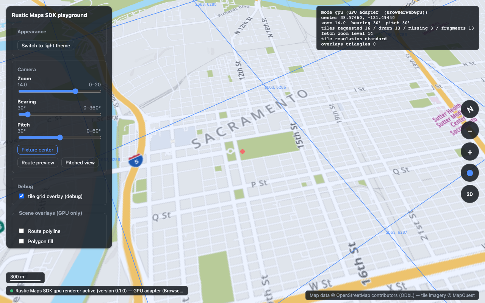
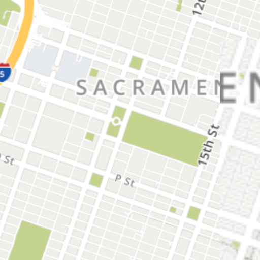
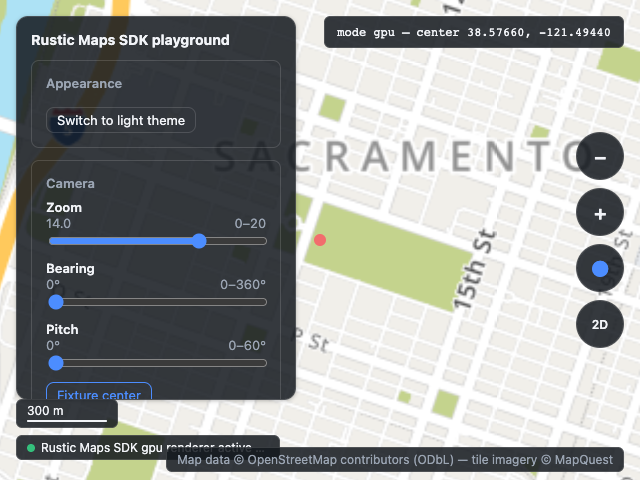

# Rustic Maps SDK

[](#license)

Rustic Maps SDK renders maps, resolves places, plans routes, follows a
turn-by-turn trip from location updates, and routes offline from an
OpenStreetMap graph. One Rust core serves Android, iOS, React Native and
WebAssembly through one UniFFI contract. Map platforms connect through
vendor-neutral provider contracts: MapQuest implements the platform API set,
and any `{z}/{x}/{y}` raster or vector source connects through the URL-template
providers.

## Start here

- **Guide:** <https://angoratek.github.io/rustic-maps-sdk-docs/> — install,
  first map, search and routing, turn-by-turn, offline maps, screenshots, and
  the API reference.
- **Live browser demo:** <https://angoratek.github.io/rustic-maps-sdk-docs/demo/>
  — the WebAssembly build, keyless: recorded demo data on live OpenStreetMap
  base tiles outside the recorded area.
- **Hosted mobile demo:**
  <https://angoratek.github.io/rustic-maps-sdk-docs/demo/mobile/> — the Android,
  iOS and React Native reference applications running on a hosted device.

**Build from source.** No versioned package release is published yet. The build
scripts below produce each platform artifact from this repository. A versioned
release adds per-file checksums and Sigstore signatures.

## Platforms

| Platform | What ships | Entry point |
|---|---|---|
| Rust core | The workspace crates: projection and camera, the `wgpu` renderer, the provider traits and integrations, navigation, and offline routing. No versioned Rust package is published yet. | The crates and traits directly |
| Android | One AAR with the Kotlin bindings, the Rust libraries for arm64-v8a, armeabi-v7a and x86_64, and the `MapView` with its Compose wrapper | `MapSdk`, `MapView` |
| iOS | An XCFramework packaged for Swift Package Manager, with the `RusticMapsSDK` bindings and the `MapNativeCoreUI` view | `MapSdk`, `MapView` |
| React Native | An npm TurboModule package with the typed `<MapView>` component and the compiled native payload | `MapsSdk`, `MapView` |
| WebAssembly | An npm ES module built with `wasm-bindgen`, including the canvas-owning `MapView` | `MapsSdk`, `MapView` |

## Features

- **One `MapView` per platform** — the shipped widgets own the rendering
  surface, frame pump, lifecycle, gestures, camera, camera animations and
  fit-bounds, overlays addressed by caller id, the location indicator, and the
  listener callbacks. Above them sit `MapSdk`, a `Navigator`, and small engine
  objects (`SearchEngine`, `RoutingEngine`, `OfflineManager`, `Diagnostics`).
- **Typed geospatial core** — coordinates, bounding boxes, routes, places,
  traffic, raster tiles, and a typed error model with `serde` serialization for
  the binding layers.
- **Ten vendor-neutral provider contracts** — geocoding, routing, distance
  matrix, search, traffic incidents, traffic flow, elevation, raster tiles,
  offline routing, and vector tiles.
- **Full map-platform provider** — geocoding, search prediction, routing, route
  matrix, traffic incidents and flow, and raster tiles in standard or retina
  resolution, with a token-bucket rate limiter, bounded idempotent retries, and
  platform status-code to typed-error mapping.
- **Any `{z}/{x}/{y}` base map** — vendor-neutral raster and vector tile
  provider crates over a validated URL template, so a base map can come from
  MapQuest, OpenStreetMap, an OpenFreeMap-style vector tileset, or your own
  server, chosen at runtime.
- **Disk response cache** — SQLite-backed, with order-independent SHA-256
  request fingerprints, per-category time-to-live buckets (tiles 30 days through
  traffic flow 30 seconds), byte-budget LRU eviction, and a free-disk-share
  quota.
- **Turn-by-turn navigation** — a pure state-machine reducer (step advance,
  two-grade deviation, reroute gate, arrival-aware progress), instruction
  composition with metric and imperial distance phrases, per-topic observers
  with cancellable subscriptions, and recorded-trace replay drivers.
- **Offline maps** — a self-describing `RMOG` routing-graph archive compiled
  from OpenStreetMap PBF extracts, a validating reader over mmap or in-memory
  bytes (wasm-safe), A* routing with turn maneuvers and an offline fallback
  provider, plus a tile-pack manager.
- **Vector tiles and labels** — a Mapbox Vector Tile v2.1 decoder and a
  data-only style pass that turns decoded layers into fill, polyline and point
  overlays, with committed Bright, Fiord, Positron, Carto Light and Carto Dark
  styles. Place names and road names draw from a glyph atlas, rotated along
  their lines, filtered by feature rank and class, and collision-rejected.
- **Rendering core** — web-mercator projection, an anchored camera with
  animations, exact frustum tile listing across the antimeridian, a frame-driven
  tile scheduler, and a byte-budget LRU texture pool feeding a headless `wgpu`
  renderer with golden-image tests and corrupt-payload degradation.
- **Browser test surface** — wasm bindings for the core and the canvas-owning
  `MapView`, a live provider path with a runtime credential, and a
  Playwright-driven end-to-end suite. The same build is the documentation
  site's live `/demo`.

## Repository layout

| Crate | Purpose |
|---|---|
| `geospatial-types` | Records, haversine math, typed errors |
| `geospatial-traits` | The ten provider contracts (with compile-time mocks) |
| `rustic-maps-core` | Provider registry and cache-then-network orchestration |
| `rustic-maps-cache` | SQLite response cache with time-to-live, LRU, and quota |
| `everymap-core`, `everymap-providers-*` | The provider layer: contracts, transport, pacing, retry and vendor integrations, including MapQuest, OSRM, Valhalla and the URL-template sources |
| `rustic-maps-rendering` | Projection, camera, tile scheduler, pool, `wgpu` renderer |
| `rustic-maps-vector-tiles` | Mapbox Vector Tile (MVT) v2.1 decoder |
| `rustic-maps-glyphs` | Glyph protocol decoder, atlas packer and range cache |
| `rustic-maps-navigation` | Turn-by-turn navigation state machine |
| `rustic-maps-positioning` | Device-position validation, smoothing and staleness |
| `rustic-maps-offline-graph-archive` | Offline routing graph archive reader and writer (wasm-safe) |
| `rustic-maps-offline-graph-compiler` | OpenStreetMap PBF to offline routing graph archive compiler |
| `rustic-maps-native-core` | UniFFI binding crate (UDL is the single contract) |
| `rustic-maps-web-bindings` | wasm-bindgen surface for the browser |

Recorded provider responses and map tiles live under `fixtures/` (golden render
tiles under `crates/rustic-maps-rendering/fixtures/`) and are replayed by the
test suites.

## Build & test

Requires **Rust 1.89+** (see `rust-version` in `Cargo.toml`).

```bash
cargo build --workspace
cargo fmt --all
cargo clippy --workspace --all-targets -- -D warnings
cargo test --workspace
```

### Build the platform packages

Each platform's package is produced by a script that prints its own
prerequisites when one is missing:

| Package | Script | Output |
|---|---|---|
| Android | `scripts/build-android.sh` | The bindings AAR and the `MapView` wrapper AAR |
| iOS | `scripts/build-ios.sh` | The XCFramework plus a verified Swift package; `scripts/build-ios-reference-application.sh` builds the sample app |
| React Native | `scripts/build-rn.sh` | The generated TurboModule sources and native payload |
| WebAssembly (npm) | `scripts/package-web-npm.sh` | The npm tarball, after the wasm build below |

### WebAssembly and browser end-to-end tests

```bash
rustup target add wasm32-unknown-unknown
cargo install wasm-bindgen-cli --version 0.2.129   # must match the dependency version
cargo build -p rustic-maps-web-bindings --release --target wasm32-unknown-unknown
wasm-bindgen --target web --out-dir platform/web/pkg \
  target/wasm32-unknown-unknown/release/rustic_maps_web_bindings.wasm
cd platform/web
npx playwright install chromium   # first time only
npx playwright test

# Or serve it manually and open the demo in a browser:
node serve.mjs                    # http://127.0.0.1:8642/
```

The GPU frame-budget measurement runs outside the test suite because the suite
renders under SwiftShader, whose numbers do not describe a real GPU:
`node platform/web/perf/run-frame-budget.mjs` (add `--layer raster` for the tile
path). The recipe is `docs/Browser.md`.

### Live provider check (optional, needs an API key)

```bash
cp .env.example .env   # add your real key; .env is gitignored
cargo run -p rustic-maps-rendering --example record_navigation_corridor_tiles -- --plan
```

The `--plan` run prints the tile set the recorder would fetch without touching
the network; drop the flag to record through the live provider. The
`record_golden_tiles`, `record_playground_tiles` and `record_demo_routes`
recorders follow the same credential rule.

## Packaging

- **Android**: two Gradle modules — `:map-sdk-native` (the generated Kotlin
  bindings and the per-ABI Rust libraries, published as Maven
  `com.angoratek:rustic-maps-sdk`) and `:maps-sdk` (the Kotlin wrapper and
  `MapView`). Both AARs are assembled by `scripts/build-android.sh`.
- **iOS**: `platform/ios/Package.swift` builds `RusticMapsSDK` (the generated
  bindings over the `rustic_mapsFFI` XCFramework binary target) and
  `MapNativeCoreUI` (the `MapView`); a release consumes a generated
  `Package.swift` with a `binaryTarget(url:checksum:)` from the
  `swift-package` branch.
- **React Native**: npm `@angoratek/rustic-maps-sdk` — the Turbo Module
  generated with `uniffi-bindgen-react-native` from the same UDL contract, its
  typed `<MapView>`, and an opt-in native payload for both platforms.
- **Web**: npm `@angoratek/rustic-maps-sdk-web` — the `rustic-maps-web-bindings`
  ES module built with plain `wasm-bindgen --target web`; no bundler required.

## Community

- [Contributing](CONTRIBUTING.md) — the path from a clone to a merged pull
  request, including the pre-commit gate and the DCO sign-off.
- [Security policy](SECURITY.md) — how to report a vulnerability.
- [Support](SUPPORT.md) — where to ask questions and report problems.
- [Code of conduct](CODE_OF_CONDUCT.md)
- [Roadmap](ROADMAP.md)

## Screenshots

**Live browser demo** (`platform/web`, served locally with `node serve.mjs`):
the wasm core drawing from JavaScript. The tile-grid overlay comes from the Rust
`visibleTileKeys` listing projected back to screen space, over the recorded
Sacramento tiles at pitch 30° and zoom 14:



**Headless GPU renderer** (`rustic-maps-rendering` golden-image test, Apple GPU shown):
recorded map tiles of downtown Sacramento (the California State Capitol) at zoom
14, top-down and pitched 45°, rendered through the `wgpu` pipeline and compared
against committed images on every test run:



**Browser GPU canvas** (`rustic-maps-web-bindings`, wasm): the same recorded tiles
rendered through `wgpu` on the browser's WebGPU adapter. Without browser WebGPU
it falls back to the 2D tile-grid overlay:



## License

Dual-licensed under **MIT OR Apache-2.0**. See [LICENSE-MIT](LICENSE-MIT) and
[LICENSE-APACHE](LICENSE-APACHE). Dependency licenses are gated by `cargo-deny`
(`deny.toml`).

## Credits

**Third-party software** — every registry dependency (name, version, SPDX
license, homepage, and copyright notices) is listed in
[docs/THIRD_PARTY_NOTICES.md](docs/THIRD_PARTY_NOTICES.md), generated from the
dependency graph by `scripts/generate-third-party-notices`. Regenerate and
commit that file whenever `Cargo.toml` or `Cargo.lock` changes.

**Data attribution** — the attribution and terms shown by the default map view
are the active provider's `attribution_text` and `terms_note` from
`platform/providers.json`. For MapQuest: "Map data © OpenStreetMap contributors
(ODbL) — tile imagery © MapQuest"; for an OpenStreetMap base map, the ODbL
notice. Keep that attribution visible in your apps, and **reproduce
`docs/THIRD_PARTY_NOTICES.md` with your own distribution**.

**Prior art and inspiration** — [MapLibre](https://maplibre.org/),
[OpenStreetMap](https://www.openstreetmap.org/),
[UniFFI](https://github.com/mozilla/uniffi-rs), and [wgpu](https://wgpu.rs/)
(credited, not copied); and [Ferrostar](https://github.com/stadiamaps/ferrostar)
(Stadia Maps, BSD 3-Clause), the navigation-core design reference whose
trip-state and step-advance-condition patterns the `rustic-maps-navigation` crate
is modeled on. Its license text is retained in
[docs/THIRD_PARTY_LICENSES/ferrostar-LICENSE.txt](docs/THIRD_PARTY_LICENSES/ferrostar-LICENSE.txt).
