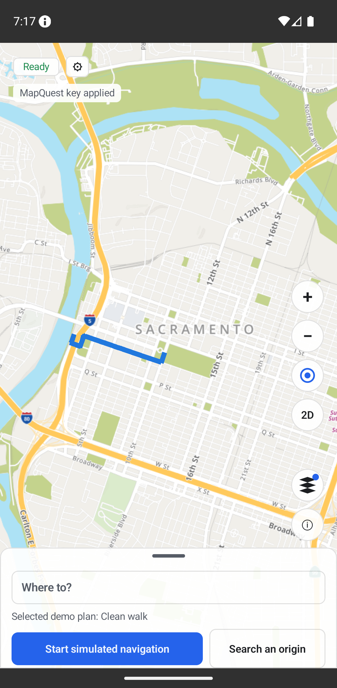
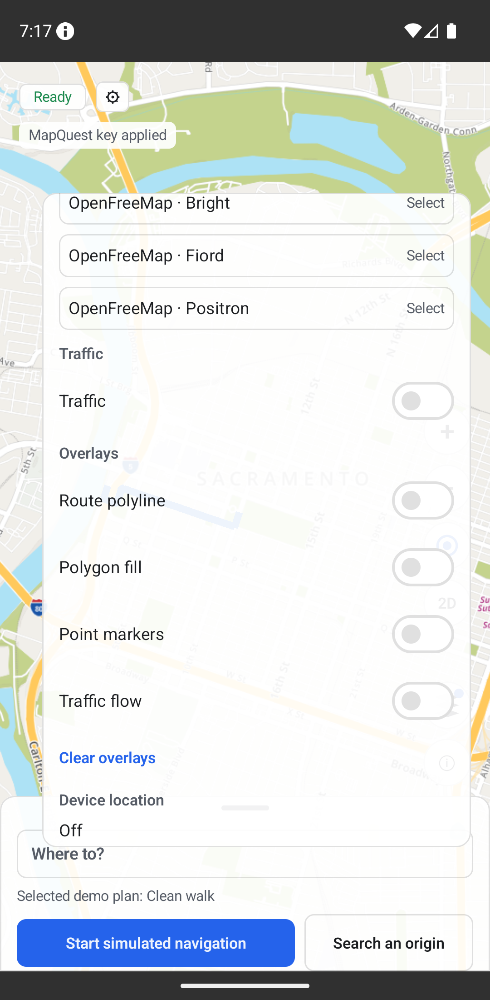
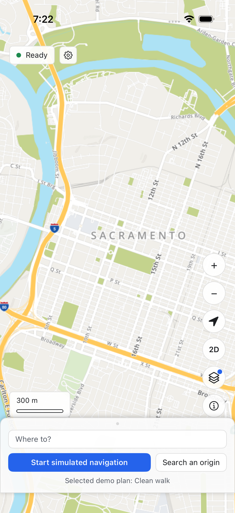
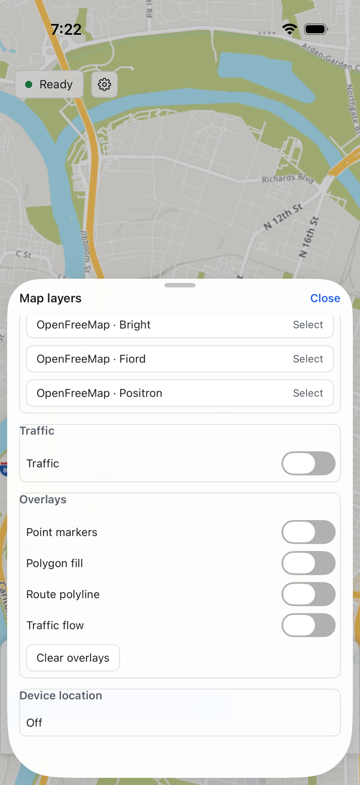
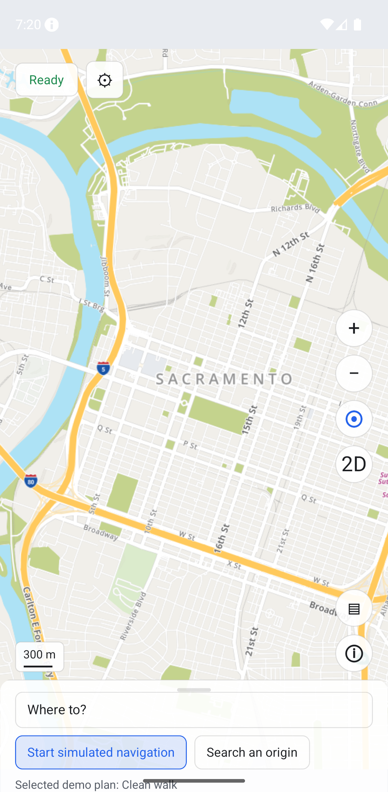
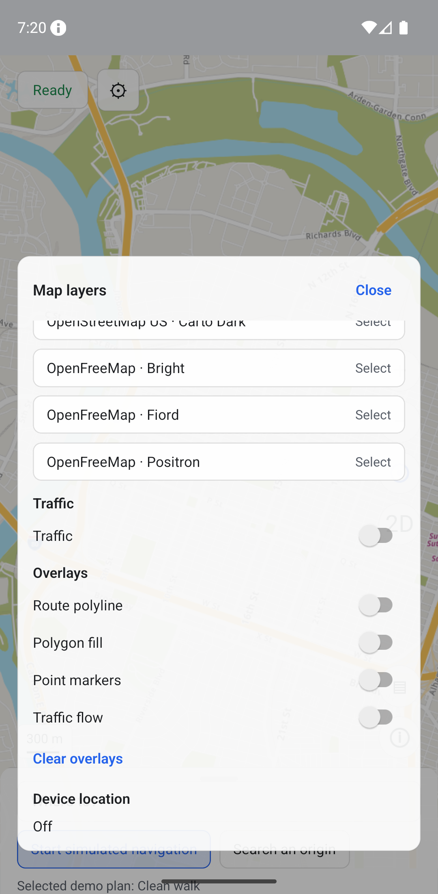
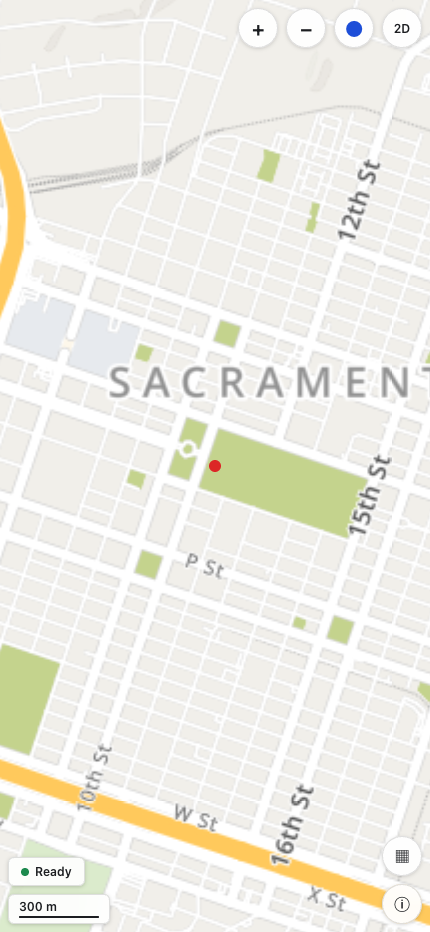
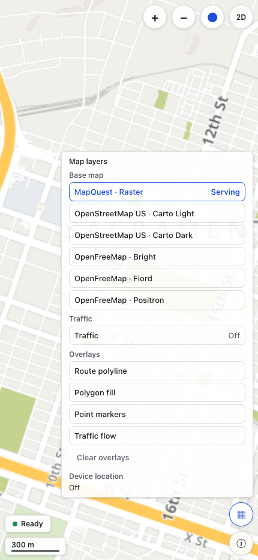

# Map layers and traffic

The floating map layers control changes what the map draws without leaving the
map. It selects the base map or vector style, turns the traffic layer on and
off, toggles demo overlays, and reports the device location source. This page
shows the control in every reference application, what each section does, and
where the settings surface stops.

## The control on every platform

The circular **Map layers** control sits directly above the attribution control
on the map's end edge. Each pair below shows the same map with the panel
closed, then open on the same camera pose. MapQuest serves the raster base.
The panel scrolls when it is taller than the phone, so the open frames show
its lower rows: the last base-map rows, **Traffic**, **Overlays** with its
**Clear overlays** action, and **Device location**.

### Android

### iOS

### React Native

### WebAssembly

## What you get

- One circular control on the map that switches the base map or vector style,
  the traffic layer, the demo overlays and the device location source.
- A panel that states an unavailable layer with the reason instead of showing
  a switch that pretends to work.
- An attribution control that follows the layers on screen.
- A settings surface that keeps provider credentials and per-capability
  providers, not a second path for the layers.

## What you need

- A reference application for Android, iOS, React Native, or the browser
  demo. A Rust application draws its own control and calls the same SDK
  operations.
- A browser with WebGPU for the browser demo.
- A MapQuest API key for live traffic. The base maps, vector styles, demo
  overlays and device location work without a key.

## Open the layers control

1. Find the circular control on the map's end edge, directly above the
   attribution control.
2. Select it. Its accessible name is **Map layers**, and it carries a dot
   while a non-default layer is active.
3. Read the panel's four sections in order: **Base map**, **Traffic**,
   **Overlays** and **Device location**. The panel opens upward and scrolls
   when it is taller than the screen.
4. Close it with **Close**, the Escape key, or the platform back action. Focus
   returns to the circular control.

In every reference application the collapsed control and the attribution
control share one diameter, so the two sit in one column on the map's end
edge.

| Platform | Where the panel appears |
|---|---|
| Rust | No reference application; your application draws its own control over the same SDK operations |
| Android | A panel in the bottom dock, above the attribution control and clear of the home sheet |
| iOS | A sheet at the panel height fraction, opened from the circular control |
| React Native | A modal panel over the map, with the same four sections |
| WebAssembly | A panel in the bottom-end dock, opened above the circular control |

## Choose a base map or a vector style

1. Open **Base map**.
2. Pick a row. The raster sources come first, in registry order, followed by
   one row for every committed vector style: Carto Light and Carto Dark from
   OpenStreetMap US, and Bright, Fiord and Positron from OpenFreeMap.
3. Read the row's state. The active row says **Serving**, a selectable row
   says **Select**, and a provider that declares a credential the session has
   not applied says **Needs API key** and stays disabled.

Selecting a vector style installs the styled base over the raster tiles and
beneath your overlays. Selecting a raster source removes the vector base, and
the attribution line follows the active entry. The vector base carries the
label note its styles earn: land, water, roads with their names, and Latin
place names. A style that declares a shield block on its route-reference layer
draws each route reference as a shaped badge; Bright, Fiord, and Positron carry
no such layer, so those bases draw no shields. The choice is remembered with
the app's other choices and restored on the next launch; the settings surface
does not repeat this selection.

## Turn traffic on

1. Open **Traffic**.
2. Turn the switch on. If no provider serves traffic flow, the switch reads
   **Needs API key** or **Not configured**, stays off, and states the reason.
3. Pan or zoom. Each settled camera asks the traffic-flow capability for the
   visible bounds after 400 milliseconds, with at most one request in flight.
   A newer camera change replaces a pending request.
4. Turn the switch off to remove the overlay and stop the requests.

While the layer is on, congestion-colored flow lines draw over the base map
and under the route and overlays. The attribution control appends the serving
provider's attribution for as long as the layer draws. A failed refresh keeps
the previous lines and shows the failure detail in the panel; a
`ProviderNotConfigured` failure turns the switch off with its reason.

## Toggle and clear the demo overlays

1. Open **Overlays**.
2. Turn one switch on for each shared demo scene you want.
3. Select **Clear overlays** to turn every scene off in one action.

A scene that cannot run right now is disabled with its reason. The scene
switches write the same remembered choice the rest of the app reads, so a
relaunch restores them.

## Use the device location source

The **Device location** row is the status and stop surface for the source. It
reads one of five states:

| State | Meaning |
|---|---|
| Off | The source is not running |
| Waiting for a fix | The source is starting and has not produced a position |
| Active | The source is running and the map can follow it |
| Permission denied | The platform refused the location permission |
| Unavailable | The platform has no usable location source |

Select **Stop** while the source runs to turn it off. While the source is on,
the app remembers the choice and starts it again on the next launch, centering
on its first fix once the location permission is already granted. Stopping the
source forgets the choice.

The circular **My location** control on the map starts the same source, asks for
permission when needed, centers on the first fix, and re-centers after you pan
or zoom away. Each route field also carries a **My location** chip that starts
the source when it is off and fills only its own field with the latest fix; a
chip that cannot start is disabled with the same reason the row states. The
home sheet's device location row is a pointer to this panel, not a second
control.

## Read attribution and terms

The attribution control is the info button on the map's end edge, labelled
**Map attribution and terms**. Its panel carries the serving base map's
attribution line and terms note. While traffic draws, the panel also carries
the traffic provider's attribution. A layer change is announced in the live
region so assistive technology hears it. Keep the attribution visible in your
application and copy the terms note into your own compliance surface.

## What the settings surface keeps

The settings surface and the map control divide the work:

- **Settings** keeps one credential row per provider that declares a
  credential, with explicit Apply and Clear actions and an opt-in remember
  choice for the device.
- **Settings** keeps one provider row per capability, in the readback order.
  Each row names the serving provider and offers a picker limited to the
  providers that declare the capability on that platform.
- **Settings** keeps the offline maps card, the diagnostics sheet and the
  theme choice.
- **The map layers control** owns the base map, the vector style, traffic,
  the demo overlays and the device location source. The raster-tile and
  vector-tile capability rows are read-only and point to the control.

The control never asks for, holds or stores a provider credential. Traffic
uses the credential the settings surface already applied.

## Expected result

After a base or style switch, the map repaints with the new imagery and the
attribution line changes. With traffic on, the panel switch reads **On** and
the flow lines draw until you turn it off. With the device location source
active, the panel reads **Active** and the circular control re-centers on your
position. After a relaunch, the same base map, traffic state, overlays, device
location source and remembered provider choices return.

## Where to go next

- [Mix providers per capability](mix-providers-per-capability.md) configures a
  different provider for search, routing and tiles.
- [Show the device's location](positioning.md) covers the permission and
  position sources the map control starts.
- [Screenshots](screenshots.md) shows the reference scenario on every
  platform.
