# Screenshots

Every capture below comes from the reference application for that platform, at
phone width, on the same recorded Capitol Park ⇔ Tower Bridge trip. Each run
injects one MapQuest credential into the session through the platform's
runtime seam; the credential is never stored in the build, the page, the image
or this page. The screenshot set is six captures per platform from one
revision: the four flow moments on this page and the layers-control pair on
the [Map layers and traffic](map-layers-and-traffic.md) page.

**These images come from an earlier build.** They were recorded before the
developer console, the map motion changes and the current provider rows. They
still show the reference scenario's flow, drawn map and vocabulary, but they
do not picture the build you can run today. The layers-control pair on the map
layers page comes from the same build.

Each platform shows the same four moments of the same flow: the plan sheet
with both endpoints chosen, the provider section with every row's display name
and credential state, the simulated trip at its first instruction with 1×
playback speed, and the styled vector base with its place labels.

## The plan sheet

The labelled Origin and Destination fields with their A/B markers, each
field's own Search action, a My location chip, and the swap action. The route
card states distance, duration, mode and strategy. The readiness chip and the
applied-key line show that the session's provider credential is serving.

### Android — Kotlin and Jetpack Compose

### iOS — Swift and SwiftUI

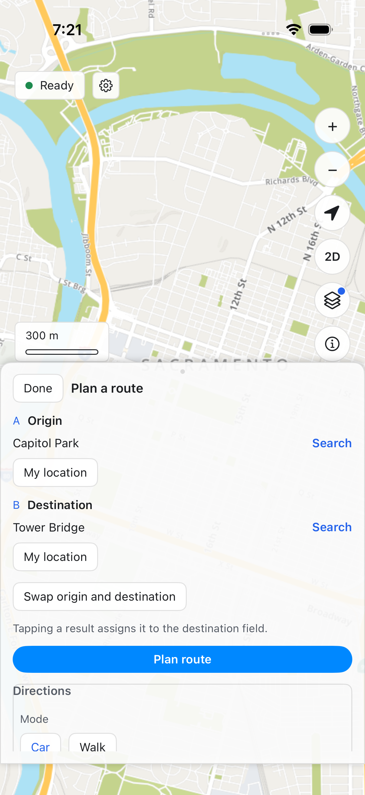

### React Native — one TypeScript surface, two native shells

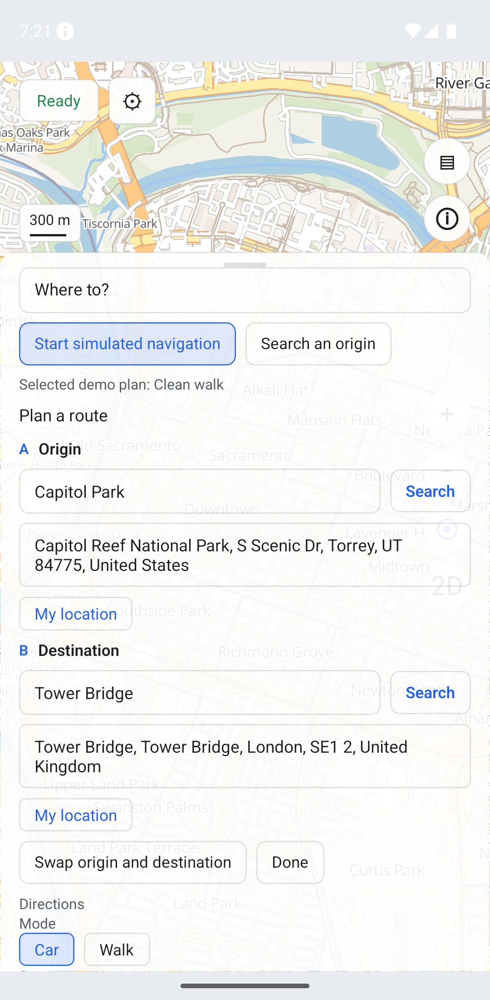

### WebAssembly — the browser build

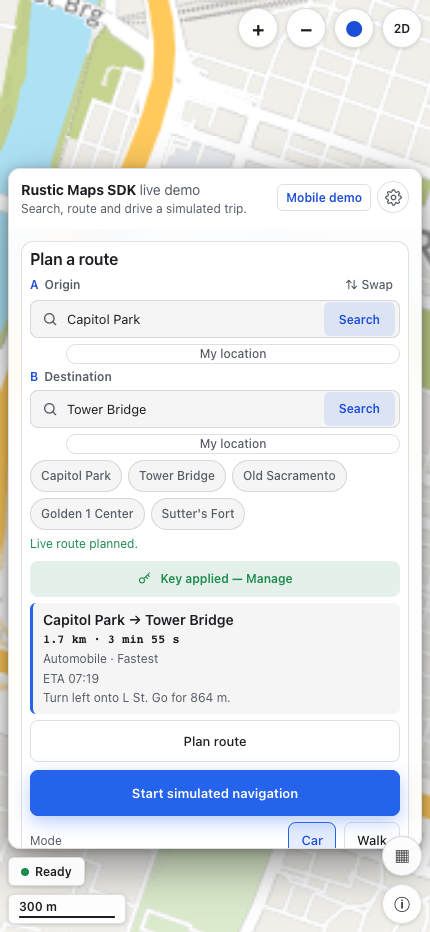

## Providers and credentials

Each capability row names the serving provider and its credential state in
one line, such as `MapQuest · Ready` or `OSRM · Ready`. A keyless routing
provider states its public demo server and the terms that server carries. The
applied provider's own row states that its key is applied.

### Android

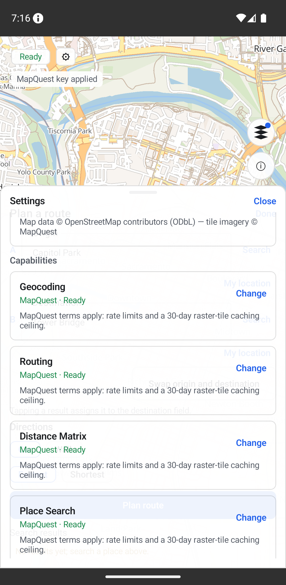

### iOS

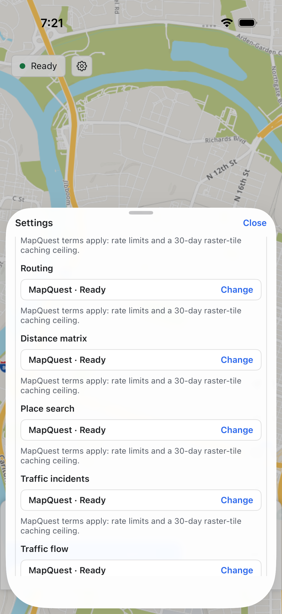

### React Native

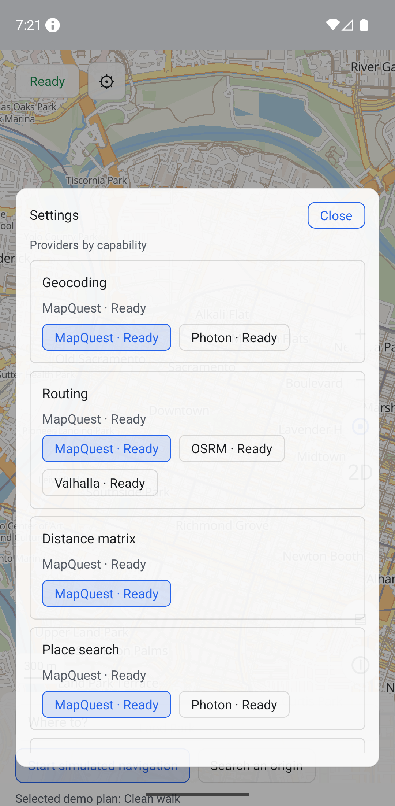

### WebAssembly

## Simulated navigation

The reference scenario at its first instruction: the turn-by-turn banner with
the next maneuver and the then line, the planned route polyline with its
endpoints, the ETA-distance line, and the playback-speed controls with **1×**
selected, beside voice guidance, pause and exit.

### Android

### iOS

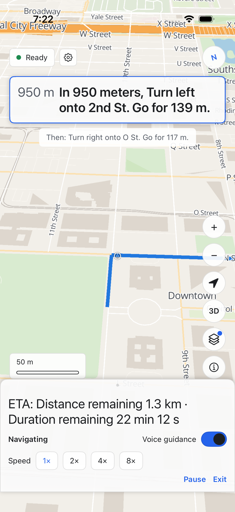

### React Native

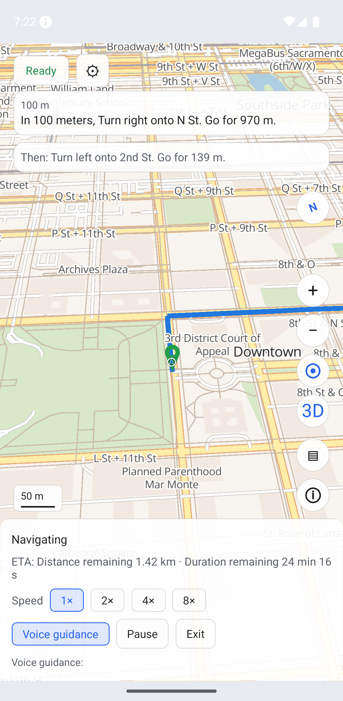

### WebAssembly

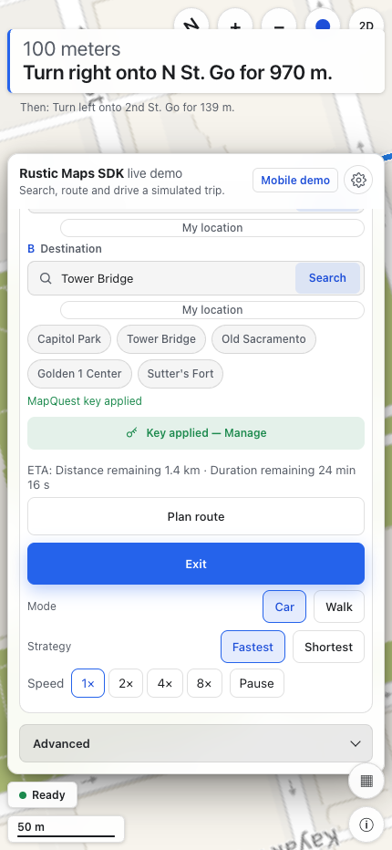

## Vector base

The OpenFreeMap Bright styled vector base with the embedded glyph atlas's
street and place labels. Streets are named along their own lines, rotated to
the road's bearing and skipped when the text would not fit; place names sit
above them, and a collision pass keeps one from covering another. They arrive
with the vector base; a raster base carries its imagery's own labels instead.
Every surface draws them, and the labels are renderer output rather than page
markup.

### Android

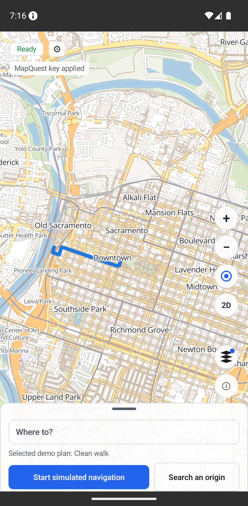

### iOS

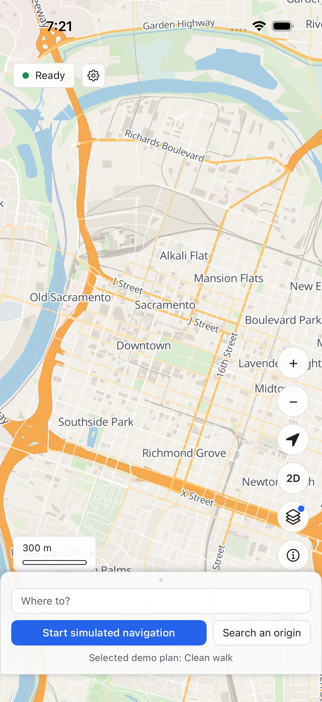

### React Native

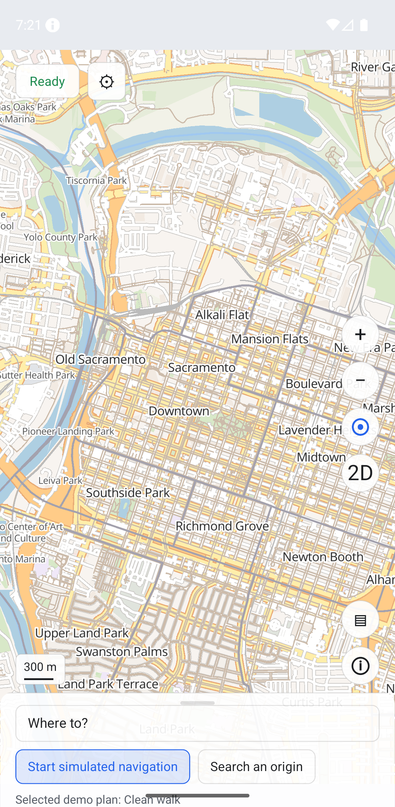

### WebAssembly

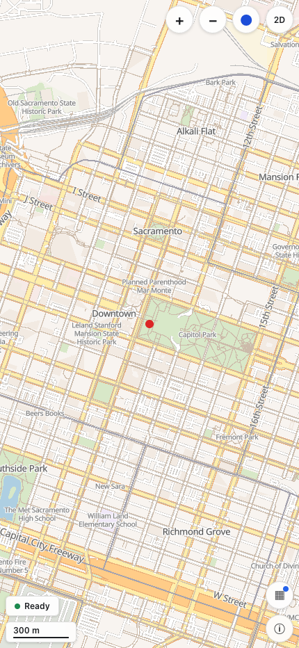

## Reading the screenshots

The six captures per platform share one design language: the four moments on
this page and the layers-control pair on the map layers page show the same
flow. They also share one vocabulary: *plan sheet*,
*Origin* and *Destination*, *Search*, *My location*, *swap*, *route card*,
*provider section*, *maneuver banner*, *then line*, *route polyline*,
*map control cluster*, *compass*, *scale bar*, *ETA-distance line*,
*speed chips*, the browser's *trip drawer*, *vector base*, and *place labels*.
Differences are the platform's own chrome: Compose's Material surface on
Android, SwiftUI's safe-area handling on iOS, the React Native host view, and
the browser's WebGPU canvas. The map content, the guidance, the control
cluster, the scale ladder and the drawn labels are the same.
